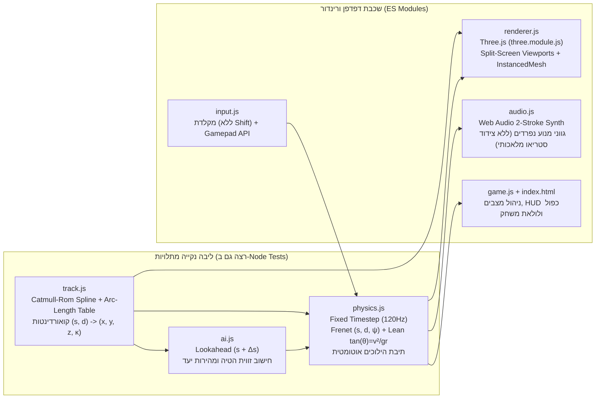

# תוכנית פיתוח מתוקנת: 500cc Grand Prix '90 — Local Split-Screen

## תיאור המטרה (Goal Description)
פיתוח משחק מרוצי אופנועי 500cc דו-פעימתיים בסגנון שנת 1990 ל-2 שחקנים על אותו מחשב (**Local Split-Screen**), בתיקייה חדשה [gp500-1990](file:///c:/projects/game/gp500-1990).

התוכנית בנויה ב-**4 שלבים מדורגים (Vertical Slices)** כך שבראש ובראשונה נבנה ונוודא **גרסה מינימלית עובדת מקצה לקצה (MVP)** עם ארכיטקטורה נקייה, פיזיקה עקבית בקואורדינטות מסלול (`s, d, ψ`), ובדיקות אוטומטיות שרצות ב-Node ללא תלות ב-Three.js.

---

## נקודות מרכזיות ששונו בעקבות המשוב ההנדסי

> [!IMPORTANT]
> **1. הפרדת לוגיקה מרינדור (`Pure JS Physics/Track` vs `Three.js ES Modules`)**:
> - `track.js` ו-`physics.js` ייכתבו ב-JavaScript טהור **ללא שום תלות ב-Three.js** (כולל מימוש עצמאי קומפקטי של עקומת Catmull-Rom סגורה וטבלת אורכי קשת). כך בדיקות ה-Node ירוצו ישירות על הקוד האמיתי.
> - הרינדור ישתמש ב-`three.module.js` מקומי עם `<script type="importmap">` וירוץ דרך שרת מקומי קל (`server.js`).

> [!IMPORTANT]
> **2. סימולציה בקואורדינטות מסלול Frenet (`s, d, ψ`) ופיזיקת הטיה אמיתית**:
> - מיקום כל אופנוע מיוצג על ידי:
>   - `s`: מרחק לאורך קו האמצע של המסלול ($0 \le s < L$).
>   - `d`: מרחק רוחבי ממרכז המסלול (חיובי לימין, שלילי לשמאל).
>   - `ψ` (psi): זווית כיוון הרכיבה ביחס למשיק המסלול בנקודה `s`.
> - **גזירת פנייה מזווית ההטיה**: המקשים שולטים בזווית ההטיה $\theta$ (עם אינרציית גלגול), וממנה נגזרת עקמומיות הפנייה של האופנוע לפי $\kappa_{\text{bike}} = \frac{g \cdot \tan\theta}{v^2}$. הפער בין $\kappa_{\text{bike}}$ לבין עקמומיות המסלול $\kappa_{\text{track}}(s)$ קובע ישירות את השינוי ב-$\psi$ וב-$d$.

> [!NOTE]
> **3. מקשים בטוחים (ללא Sticky Keys וללא Ghosting) ושמות מקוריים**:
> - שימוש ב-`Space` לשחקן 1 וב-`Enter` לשחקן 2 עבור Tuck-in (ללא מקשי `Shift` שמקפיצים חלון Sticky Keys ב-Windows).
> - שימוש בשמות מקוריים לאופנועים ולמסלולים תחת השם **`500cc Grand Prix '90`** בתיקייה `gp500-1990/`.
> - לפני תחילת העבודה נשמור ב-commit את השינוי הקיים ב-`game.js` של משחק ה-Bubble Shooter כדי לשמור על עץ Git נקי.

---

## ארכיטקטורת המערכת והפרדת המודולים



---

## מודל הפיזיקה בקואורדינטות מסלול (`physics.js` & `track.js`)

בכל צעד זמן קבוע (`FIXED_DT = 1 / 120` שניות):

1. **עדכון זווית הטיה ($\theta$)**:
   הקלט האופקי (`steerInput` בטווח `[-1, 1]`) קובע זווית הטיית יעד $\theta_{\text{target}} = \text{steerInput} \cdot \theta_{\max}$, והאופנוע עוקב אחריה תחת קצב גלגול ואינרציה ($\dot{\theta}$):
   ```javascript
   const targetLean = input.steer * MAX_LEAN_RAD; // ~55 deg
   const leanAccel = (targetLean - rider.lean) * LEAN_STIFFNESS - rider.leanRate * LEAN_DAMPING;
   rider.leanRate += leanAccel * dt;
   rider.lean = clamp(rider.lean + rider.leanRate * dt, -MAX_LEAN_RAD, MAX_LEAN_RAD);
   ```

2. **גזירת קצב הפנייה והתקדמות ב-`(s, d, ψ)`**:
   מעקמומיות המסלול $\kappa_{\text{track}}(s)$ ומהירות האופנוע $v$:
   ```javascript
   // עקמומיות הפנייה שנוצרת מזווית ההטיה: κ_bike = (g * tan(θ)) / max(v², v_min²)
   const effSpeedSq = Math.max(rider.speed * rider.speed, 36.0);
   const lowSpeedSteer = (rider.speed < 12) ? (input.steer * 0.08 * (1 - rider.speed / 12)) : 0;
   const bikeCurvature = (GRAVITY * Math.tan(rider.lean)) / effSpeedSq + lowSpeedSteer;

   const trackSample = track.sampleAtS(rider.s); // { x, y, z, tangentAngle, curvature, width }
   const denom = Math.max(0.25, 1.0 - rider.d * trackSample.curvature);

   const ds = (rider.speed * Math.cos(rider.psi)) / denom * dt;
   const dd = (rider.speed * Math.sin(rider.psi)) * dt;
   const dPsi = (rider.speed * bikeCurvature - trackSample.curvature * (ds / dt)) * dt;

   rider.s = track.wrapS(rider.s + ds);
   rider.d += dd;
   rider.psi = clamp(rider.psi + dPsi, -Math.PI / 2.2, Math.PI / 2.2);
   ```
   - כאשר הרוכב מטה את האופנוע בדיוק בזווית המתאימה למהירות ולרדיוס הפנייה ($\kappa_{\text{bike}} \approx \kappa_{\text{track}}$), מתקיים $\dot{\psi} \approx 0$ והאופנוע שומר על קו המרוץ.
   - אם הרוכב נכנס מהר מדי או לא מטה מספיק, $\psi$ נפתח החוצה ו-$d$ גדל באופן טבעי לכיוון אבני השפה והחצץ.

3. **ספירת הקפות ודירוג ב-$O(1)$**:
   - `rider.totalDistance = rider.lap * track.totalLength + rider.s`.
   - מעבר מ-$s \approx L$ ל-$s \approx 0$ בכיוון חיובי מעלה את `rider.lap`.
   - הדירוג (`1st` עד `8th`) הוא פשוט מיון לפי `totalDistance` בסדר יורד.

---

## תוכנית עבודה מדורגת ב-4 שלבים (Phased Implementation)

### שלב 1: גרסה מינימלית עובדת מקצה לקצה (MVP Core)
**מטרה**: משחק 2 שחקנים עובד, יציב ובדוק מקצה לקצה על מסלול אחד.

#### [NEW] [server.js](file:///c:/projects/game/gp500-1990/server.js)
- שרת HTTP סטטי קל ב-Node.js שמגיש את קבצי המשחק וה-ES Modules עם כותרות MIME מתאימות.

#### [NEW] [track.js](file:///c:/projects/game/gp500-1990/track.js)
- מימוש טהור ב-JS (ללא Three.js) של עקומת Catmull-Rom סגורה עם טבלת דגימות באורך קשת קבוע (`Arc-Length Parameterization`).
- מסלול ראשון: **Sakura GP Circuit** (מסלול 1990 קלאסי זורם עם ישורת ראשית, פניות מהירות ושיקיין).
- פונקציות `sampleAtS(s)` ו-`frenetToWorld(s, d)` להמרה מ-`(s, d)` לקואורדינטות עולם `(x, y, z, heading)`.

#### [NEW] [physics.js](file:///c:/projects/game/gp500-1990/physics.js)
- לולאת Fixed Timestep (`120Hz`).
- תאוצה של מנוע 500cc דו-פעימתי, בלימה, גרר אווירודינמי, ותיבת 6 הילוכים **אוטומטית**.
- פיזיקת הטיה ופנייה ב-`(s, d, ψ)` והאטה ביציאה משולי האספלט (`|d| > halfWidth`).
- מעקב הקפות (`lap`, `lapTime`, `bestLapTime`, `totalDistance`).

#### [NEW] [input.js](file:///c:/projects/game/gp500-1990/input.js)
- שחקן 1: `W`/`S` (גז/ברקס), `A`/`D` (הטיה), `Space` (Tuck-in).
- שחקן 2: `ArrowUp`/`ArrowDown` (גז/ברקס), `ArrowLeft`/`ArrowRight` (הטיה), `Enter` או `Numpad0` (Tuck-in).

#### [NEW] [renderer.js](file:///c:/projects/game/gp500-1990/renderer.js)
- שימוש ב-`three.module.js` מקומי.
- רינדור מסך חצוי אופקי (למעלה/למטה) עם שתי מצלמות מעקב.
- בניית mesh הכביש, אבני השפה, ושימוש ב-`THREE.InstancedMesh` לעצמים חוזרים לצמצום Draw Calls.

#### [NEW] [index.html](file:///c:/projects/game/gp500-1990/index.html), [style.css](file:///c:/projects/game/gp500-1990/style.css), [game.js](file:///c:/projects/game/gp500-1990/game.js)
- HUD בסיסי וברור לכל שחקן: מהירות (`KM/H`), הילוך (`1-6`), מד סל"ד, מספר הקפה (`LAP 1/3`) ומיקום (`POS 1/2`).

#### [NEW] [test_gp500.js](file:///c:/projects/game/gp500-1990/test_gp500.js)
- בדיקות אוטומטיות ב-Node לאימות רציפות ה-Spline, פיזיקת ההטיה (`tanθ = v²/gr`), התקדמות ב-`s`, סטייה ב-`d` בפנייה מהירה מדי, וספירת הקפות.

---

### שלב 2: מרוץ מלא (AI Grid, Start Lights & Results)
- **[NEW] [ai.js](file:///c:/projects/game/gp500-1990/ai.js)**: הוספת 6 רוכבי AI שמשתמשים באותה פיזיקת `(s, d, ψ)` עם קריאת עקמומיות קדימה (`sampleAtS(s + lookahead)`), התאמת מהירות לפני פניות, ושמירה על מרחק מרוכבים סמוכים.
- אורות זינוק (Start Gantry Countdown), דירוג חי של 8 רוכבים (`1st–8th`), ומסך תוצאות בסיום המרוץ.

---

### שלב 3: תחושה וליטוש (Audio, Gamepads, Bike Roster & Split Toggle)
- **[NEW] [audio.js](file:///c:/projects/game/gp500-1990/audio.js)**: סינתזת Web Audio API של מנוע 2-פעימות עם גוון (Timbre/Harmonics) מובחן לכל אופנוע ואיזון ווליום חכם (ללא הפרדת סטריאו שמאל/ימין מלאכותית).
- **[NEW] [bikes.js](file:///c:/projects/game/gp500-1990/bikes.js)**: בחירה מתוך 4 אופנועי 500cc מקוריים בהשראת 1990 (**Akagi V4-500 #1**, **Shiden NSR-V #4**, **Kaze RGV-500 #34**, **Corsa 500 Italia #27**).
- תמיכה ב-2 שלטים (Gamepad API) ומקש `V` להחלפת כיוון המסך החצוי (אופקי / אנכי).

---

### שלב 4: עומק Simcade ומסלולים נוספים
- רצועת כוח דו-פעימתית חדה עם **Powerslide** (החלקת זנב ביציאה מפנייה בהטיה חדה + עשן צמיגים) ו-**Highside** בחריגה קיצונית.
- **Wheelie** בהילוכים נמוכים, **Slipstream** בישורות, רעידות על אבני שפה (Kerbs), ואנימציית **Knee-Down** לרוכב בתלת-ממד.
- הוספת מסלולים נוספים (**Monterey Ridge** עם שינויי גובה ו-**Cathedral TT**).

---

## תוכנית בדיקות ואימות (Verification Plan)

### בדיקות אוטומטיות (Automated Tests)
נריץ בכל שלב:
```powershell
node c:\projects\game\gp500-1990\test_gp500.js
```
הבדיקות יוודאו:
1. סגירות ורציפות מסלול ה-Spline (`sampleAtS(0)` מול `sampleAtS(totalLength)`).
2. עקביות פיזיקלית: אופנוע שמוטה בזווית $\theta = \arctan(\kappa \cdot v^2 / g)$ שומר על $d$ קבוע לאורך פנייה ברדיוס קבוע, ואופנוע שנכנס ללא הטיה נסחף החוצה ב-$d$.
3. תיבת הילוכים אוטומטית, ספירת הקפות, התקדמות AI ללא ירידה מהמסלול, וטעינת כל קבצי המשחק וה-ES Modules משרת ה-HTTP המקומי ב-`200 OK`.

### אימות ידני (Manual Verification)
1. הרצת `node c:\projects\game\gp500-1990\server.js` ופתיחת המשחק בדפדפן.
2. בדיקת שליטה במקביל ב-2 שחקנים (`WASD + Space` מול `Arrows + Enter`) במסך חצוי ב-60 FPS.

---

## סטטוס אונליין 1v1 (עודכן 2026-11-19)

**נעשה:**
- [x] הקוד: הכפתורים נדלקים לבד כש-`/api/room?action=status` עונה `{ online: true }`; בדיקת שני דפדפנים מקצה לקצה עוברת (חדר, P2P, מירוץ מסונכרן, 0 שגיאות).
- [x] Vercel: `GP500_ONLINE=1` (Production + Preview).
- [x] Upstash Redis (Free, Washington D.C.) מחובר לפרויקט `gp500-1990` עם קידומת `KV` → `KV_REST_API_URL`, `KV_REST_API_TOKEN`.

**עוד לא נעשה (נדחה בכוונה):**
- [ ] **Cloudflare TURN** — ליצור מפתח (Realtime → TURN Server) ולהוסיף ב-Vercel `TURN_KEY_ID` ו-`TURN_API_TOKEN` (Production + Preview). בלי זה האונליין עובד ב-STUN בלבד, וחיבורים מגלישה סלולרית / רשתות ארגוניות עלולים להיכשל.
- [ ] **מיזוג ל-`main`** — השינויים בענף `ccr-0f026dfd-b1bt8a`; האתר הציבורי נבנה מ-`main`, ורק בנייה חדשה קולטת את משתני הסביבה.
- [ ] **בדיקה אמיתית** — מחשב מול טלפון על גלישה סלולרית; אחרי TURN גם עם `&relay=1` (תג `RELAY`).
